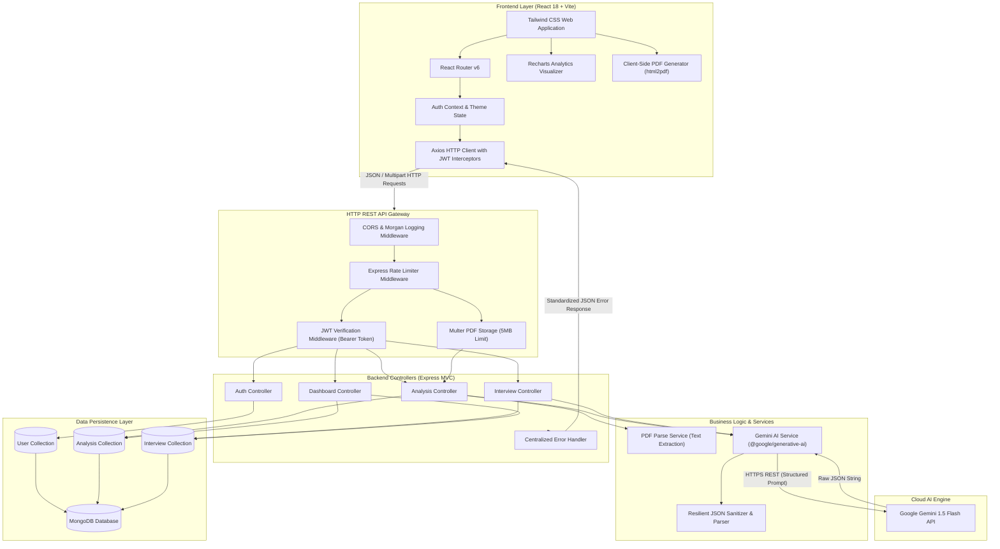
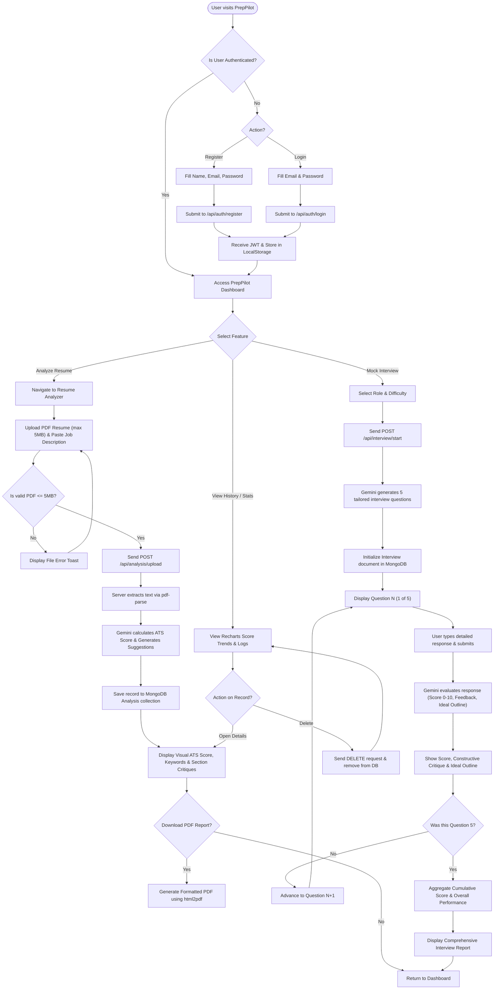
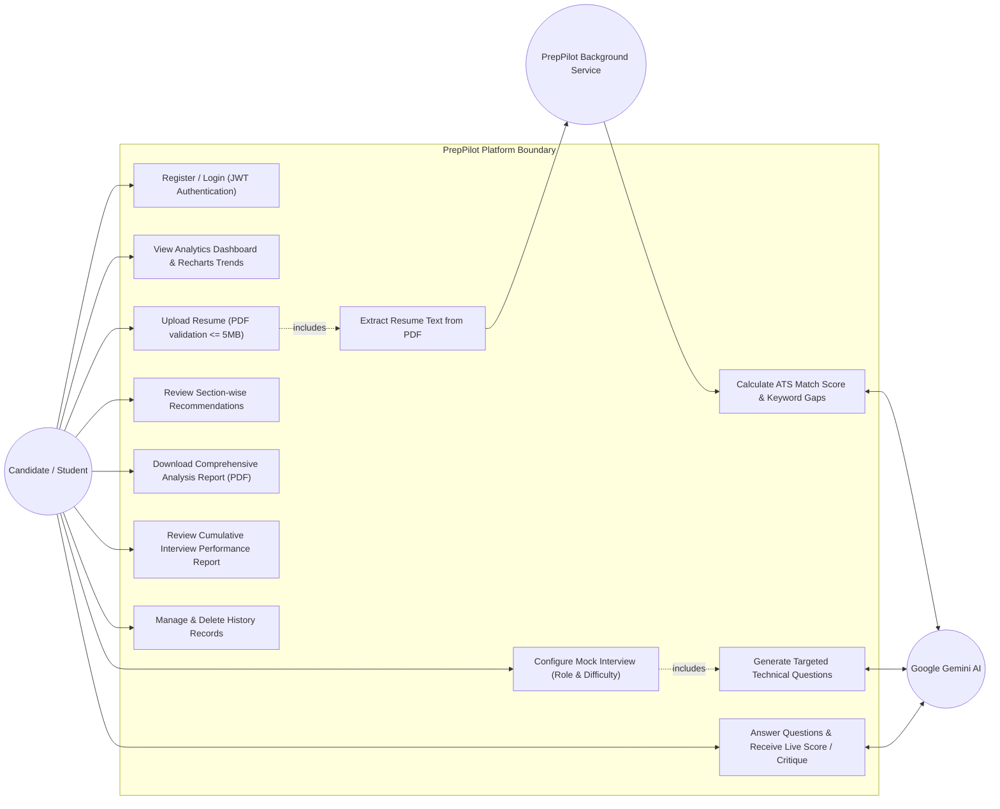
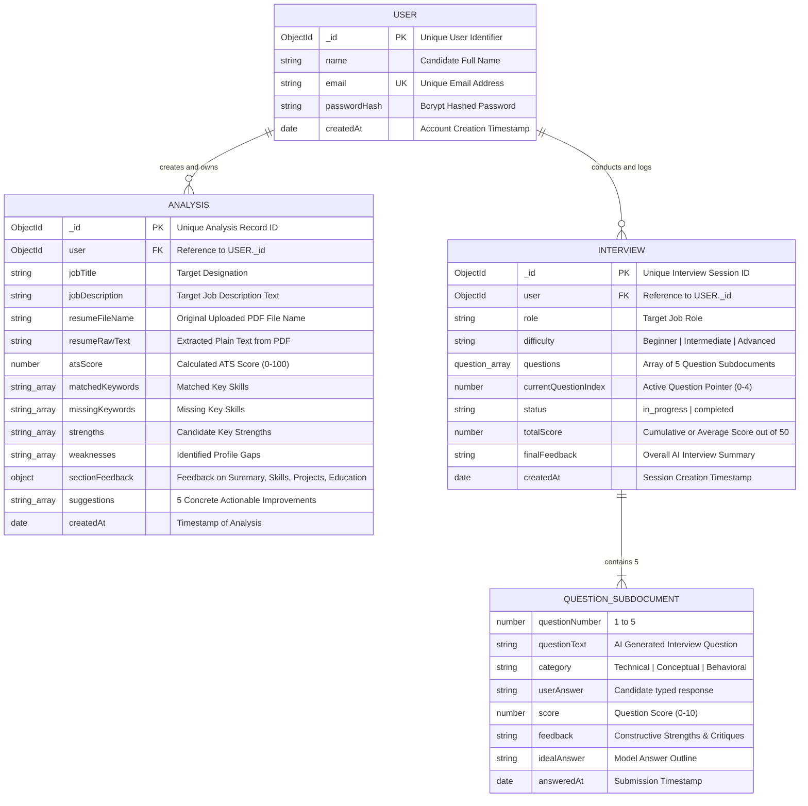
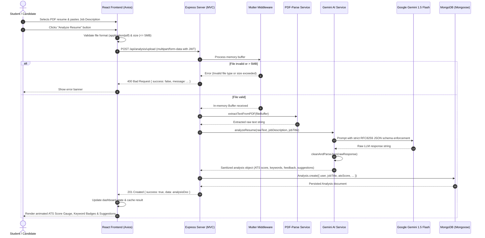

# PrepPilot — System Diagrams & Visual Documentation

This document contains all architectural, structural, and behavioral diagrams for the **PrepPilot** college mini project. All diagrams are authored in GitHub Flavored Markdown-compatible Mermaid syntax.

---

## 1. System Architecture Diagram

This diagram illustrates the overall system topology, detailing how the React frontend, Node/Express backend, MongoDB database, file processing engine, and Google Gemini Generative AI communicate.

---

## 2. Activity Flowchart (User Journey)

This flowchart models the end-to-end lifecycle of a candidate using PrepPilot: from registration to resume audit and mock interview coaching.

---

## 3. Use Case Diagram

This diagram displays the primary functional use cases supported by PrepPilot for job-seeking candidates and administrative/system services.

---

## 4. Entity-Relationship (ER) Diagram

This diagram details the schema attributes, primary/foreign keys, and data relationships between `User`, `Analysis`, and `Interview` entities in MongoDB.

---

## 5. Sequence Diagram: Resume Analysis Workflow

This sequence diagram illustrates the precise runtime interaction for the **Resume Analysis** feature: from the candidate uploading a PDF to Gemini extracting insights and MongoDB persisting the record.

